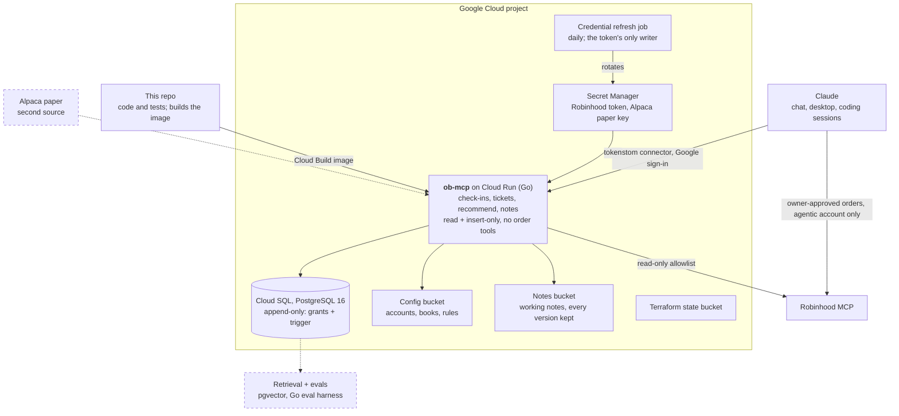

# Architecture — `options-book`

How the code is put together and how to extend it without breaking the parts that matter.
Read `CLAUDE.md` first for the hard rules and the status; `README.md` for the command reference.

## The system at a glance

How the pieces are deployed, as of 2026-11-23. Solid lines are running; dashed lines and
nodes are planned or not yet live.



The server never places an order: Claude places orders only through the broker's own
connector, and only after the owner says yes. See "Storage and credentials" below for why
each piece is built the way it is.

## Three binaries, one module

| Binary | Package | Contacts a broker? |
|---|---|---|
| `ob` | `cmd/ob` | **No.** Pure functions over saved Robinhood MCP responses |
| `agent-tools` | `cmd/agent-tools` | **Yes**, Alpaca **paper** only (`internal/alpaca`), pinned to `paper-api.alpaca.markets`. Serves MCP over stdio |
| `ob-mcp` | `cmd/ob-mcp` | **No.** The remote MCP server, on Cloud Run behind Google sign-in: the wheel-book tools over the append-only store (Cloud SQL in the live deployment), plus `recommend` and the notes tools. Pulls from Robinhood only through a compiled read-only allowlist (`internal/rhmcp`). No order path; every write is a create, and every figure-producing call records a `run` |

Every binary lives under `cmd/` (the repo root holds no Go package). `cmd/ob`'s tests name
snapshots, history and fixtures relative to the repo root, so its `TestMain` moves there first.

The boundary between them is a hard rule, not a style choice — see `CLAUDE.md`. Nothing in
the `wheel` path gains an order code path, and the Alpaca exception never widens to real
money or to Robinhood.

## Package map and dependency direction

Dependencies point one way: broker/config/format/rules at the bottom, pure math above
them, the domain model above that, and renderers and `cmd/ob` on top. **No package
imports one above it.**

```
cmd/ob, cmd/agent-tools                 wiring, flags, output, exit codes
  rhmcp  cred                            Robinhood read-only client; credentials (phase 5)
  obmcp                                  the server's tools: report over the store, run records
  report                                 every figure-producing command's output (CLI and tools)
  render   diff   reconcile   risk       on top of the model
  store                                  the append-only store (Cloud SQL, Firestore), importer, Source, export/verify (above snapshot)
    book                                 domain model + every check
      ledger                             pure math: orders → legs, blocks, breakevens
        snapshot   history                loading, sealing, replay
          rh   config   rules   format   decode, config, rule numbers, display
            alpaca                        (independent: paper broker + its MCP tools)
```

| Package | Holds |
|---|---|
| `internal/rh` | Raw Robinhood MCP response types. Decodes, never interprets. `LoadJSON` refuses a paginated response whose `next` cursor is set. **Imported only by the Robinhood adapter** (`TestOnlyTheAdapterImportsRH` fails the build otherwise) |
| `internal/broker` | The canonical types every adapter decodes into (`Order` with a canonical `State` beside the broker's own word, `Leg`, `Execution`, positions, `Balance`, quotes, `Instrument`, `RealizedPnL`, bars), the `Decoder` and `OrderSync` interfaces and a registry. `OrderSync` is what an order log needs of a broker: an order record's head and version key, which states are final, how a list response pages, and the text of the next pull. A number is a `Num` holding the broker's exact text, so a figure prints the same characters whichever adapter produced it |
| `internal/broker/robinhood` | The Robinhood adapter: the only importer of `internal/rh`. Maps Robinhood's order states (queued, unconfirmed, confirmed, partially_filled and pending_cancelled are `open`) |
| `internal/broker/conformance` | The suite every adapter's decoder must pass on its own samples |
| `internal/layout` | Where things live in the repo layout: the directories, the file names inside a snapshot, the order logs, the config files, and the slash paths built from them (`Snapshot(id)`, `AccountFile`, `OrdersPull`, `OptionFile`, `Log(acct)`, `Bars`, `PnL`, `BookConfig`, …). Pure path computation shared by the files Source and the store Source. `TestNoPathLiterals` fails the build if any other package spells a repo path or a snapshot file name |
| `internal/config` | `config/accounts.json` (every account: identity, source, default book, execution modes) joined with `books/<book>/book.json` (strategy, campaign start, the accounts the book covers with their pools, expected symbols and block starts) into one `Book`. Unknown fields, a full account number and an account the book doesn't own are refused |
| `internal/rules` | A book's `books/<book>/rules.json`, validated on load. `RoundToTick`, `Tick`, `RequiredClearance`, `IsMetal` |
| `internal/format` | The **only** place a figure is rounded for display: `USD`, `Price`, `Pct`, `Signed` |
| `internal/ledger` | Orders → `Leg`s, realized P&L, blended fills, `Block` premium and Rule 11 breakevens. Plus `expirations.go`: how a contract that ran through expiry ended |
| `internal/snapshot` | Loads a `snapshots/<id>/` folder; `Check` lists what's missing with the exact call to fix it; `WriteManifest` seals it; `ParseID` is the one parser of snapshot ids; `ReplayRef` rebuilds orders from the log |
| `internal/history` | The append-only order-version log, incremental pulls, exact prefix replay |
| `internal/report` | The output of `ledger`, `checkin`, `ticket`, `recommend`, `book`, `diff`, `reconcile`, `db list`, `db show`: functions over a `snapshot.At` writing to an `io.Writer`. The CLI and `ob-mcp` both call them, which is what makes a tool byte-identical to the CLI (`recommend` has no CLI twin: it pulls a live chain, so only `ob-mcp` calls it) |
| `internal/cred` | Phase 5 credential layer: `Provider` (`robinhood`, `alpaca-paper`), `Vault` over Secret Manager versions, `Rotate` (refresh under 48h left; keep at most two versions). Never prints a secret. The paper pin must equal `internal/alpaca`'s (tested there) |
| `internal/rhmcp` | `ob-mcp`'s Robinhood MCP client. Only the 12 tools on `Allowlist`; a mutating name fails `TestAllowlistIsReadOnly` and panics at init. Returns `content[0].text` verbatim; follows `next` or refuses |
| `internal/obmcp` | `ob-mcp`'s tools. Each figure-producing tool calls `report`, returns its text unchanged, and records a `run` (exit code and run id go in structured content only) |
| `internal/gauth` | Google sign-in for `ob-mcp`: protected-resource metadata, the token + allowed-account check, source logged never gated (B6). Copied from the phase 1 spike |
| `internal/store` | The store's collections behind a create-only `DB` with three backends: `Postgres` (`postgres.go`, one `doc` table from `postgres_schema.sql`; `NewCloudSQL` reaches Cloud SQL through the Go connector with IAM sign-in, no password), `Firestore` (REST) and `Mem` for tests. Cloud SQL is the live store; Firestore is still the code's and Terraform's default (`STORE`, `store_backend`). `ImportRepo` from today's files; `Open` reads the store back as the repo layout (an `fs.FS` Source) and refuses it on any hash, chain or seal mismatch; `Export` / `ImportExport` / `Verify`. `storetest.Sources` gives tests every source |
| `internal/notes` | The owner's working notes (`PLAN.md`, `BUGS.md`, design docs) in a private, versioned bucket (`NOTES_BUCKET`), standard library only. A `Store` (`List`, `Read`, `Write`) with an in-memory twin for tests and a Cloud Storage JSON API client. **Every write is guarded by the generation the caller read** (`ifGenerationMatch`; 0 creates), so a stale edit is a `*ConflictError` instead of an overwrite, and the versioned bucket keeps every earlier generation. `Change` applies one of three edits (replace all, append, or replace the one place `old` occurs) to the note as read and writes it back against the same generation. **There is no delete path** at any layer, and no note is larger than 1 MiB. `obmcp`'s `notes_list`, `notes_read` and `notes_write` are the only way a Claude session reaches it, and they exist only when `NOTES_BUCKET` is set; an unusable bucket is logged and reported by the tools, never fatal to the server |
| `internal/strategy/wheel` | The domain model — `Book → Pool → Account → Block → ShortCall/ShortPut → Closer` — and `Check` on each. Also `Ticket` (proposals) |
| `internal/render` | Markdown wheel-book tables, golden-tested, spliced between `BEGIN/END GENERATED` markers |
| `internal/diff` | What changed between two snapshots |
| `internal/reconcile` | Ledger realized vs Robinhood's own realized option P&L |
| `internal/risk` | Rule 6 per-position and aggregate caps for the agent's proposals. Contacts no broker |
| `internal/alpaca` | Alpaca paper client and its MCP tools |

## Vocabulary

Get these right and the code reads easily; get them wrong and the figures are wrong.

- **Contract key** — `ContractKey{Symbol, Type, Strike, Expiry}`, printed as `AAA $74c 2026-11-20`.
- **Leg** — one position *episode* on a contract, flat to flat. Several opening orders on
  the same contract blend into one leg; closing it to zero ends it. Opening it again later
  is a **new** leg.
- **Blended fill** (`Leg.FillPerShare`) — total opening credit ÷ (contracts × 100). Rule 10's
  closer is computed from this, not from any single order's price.
- **End state** — `open`, `bought_back`, or expired/assigned. An expiry with no closing
  order is **unresolved** until `ob expirations` records the underlying's close for that
  date; resolved it becomes assigned (call: close > strike) or expired worthless. An
  unresolved leg is a check-in defect (`expiration_unresolved`), never a guess.
- **Block** — `(account, symbol)`: the share holding the wheel writes calls against.
  Premium is the net premium of all non-acquisition legs on the symbol since the block
  started, **including open legs' credit**. After a full call-away the block restarts the
  day after that expiry.
- **Breakeven (Rule 11)** — `(shares × basis − premium) ÷ shares`.
- **Acquisition put** — a put written to buy the shares. Its credit is already inside
  Robinhood's average cost, so it is **share basis, not realized premium**, and it must
  never be counted again in Rule 11. It correctly has no closer.
- **Defect vs alert** — a `Finding` with `Severity` `defect` (an order is wrong; fix it in
  Robinhood) or `alert` (needs judgment: a Rule 3 roll trigger, a concentration cap (only for a book whose rules.json lists `concentration_caps`; the IRA wheel book dropped its Rule 4 metals cap 11/18),
  uncovered shares, a missing input). `ob checkin` exits 1 on any defect.

## Invariants

Breaking one of these is how a wrong number reaches a document.

1. **Money is `decimal.Decimal`.** Compare with `.Equal` / `.Cmp`. Never `==`, never
   `float64`, and no wrapper type around it (that was considered and rejected).
2. **Dollar totals from Robinhood must be whole cents** (`wholeCents`); a sub-cent total is
   an error, not something to round. Per-share quotients keep `ledger.DivPlaces` (10)
   places. Round for display only, only in `internal/format`.
3. **Cash comes from executions**, `price × qty × multiplier`, and is cross-checked against
   the order's `processed_premium`. A mismatch is an error.
4. **Only single-leg sell-to-open / buy-to-close orders are accepted.** Anything else is an
   error rather than a guess — that is why the taxable spreads are out of scope.
5. **`history/<acct>/orders.jsonl` is append-only.** Never edit, reorder or rewrite a line.
   A snapshot references a prefix of it by line count plus sha256; rewriting history makes
   every snapshot that points at it fail to load, which is the intended behaviour.
6. **A sealed snapshot is immutable.** Once `manifest.json` exists, nothing may be added —
   `history add` refuses a sealed folder *before* it appends to the log, so the log and the
   snapshot can't fall out of step (that was B2).
7. **An order's version excludes `updated_at`.** Robinhood touches every resting GTC order
   each morning; including it would log a change every day (fixed once already — don't
   reintroduce it).
8. **Snapshot ids go through `snapshot.ParseID`** (`YYYY-MM-DD`, `YYYY-MM-DDTHHMM`,
   `YYYY-MM-DDTHH:MM`). Nothing derives an as-of date from the clock (B1, B3).
9. **Legs before `campaign_start` (2026-08-19) are excluded** from realized premium.

## Bugs behind the invariants (B1–B8)

Code comments and tests cite these by number (B1, B2, …). Each was a tool bug, fixed by a
commit with a regression test; the number is kept so the comment still leads somewhere.
(A **tool bug** is a mistake in this code. A **defect** is a problem with an order in a
broker account, found by `ob checkin`. They are different things.)

- **B1 — one parser for snapshot ids.** `diff` once rejected an intraday id (`2026-11-10T1012`)
  that every other command accepted. Now `snapshot.ParseID` is the only parser, so a form
  can't be valid for one command and invalid for another. Two intraday ids on one session
  order by time; a date-only id and an intraday id on the same session are refused as
  ambiguous. Test: `TestSnapshotIDsAcceptedByEverySubcommand`.
- **B2 — a sealed snapshot takes no writes.** `history add --snapshot` once wrote into a
  folder that already had a `manifest.json`, breaking its own seal. The check must come
  *before* the log is appended; refusing only when writing `history.json` would leave the
  log ahead of the snapshot. Test: `TestHistoryAddRefusesSealedSnapshot`.
- **B3 — nothing dates a figure by the clock.** A snapshot name that wasn't a plain date
  fell back to `time.Now()`, so days to expiry, the Rule 3 trigger and the Rule 5 cooldown
  were computed against the day the command ran, with no error. Now an unrecognised name is
  an error and the as-of date is the id's session date. Test: `TestUnknownSnapshotNameIsRefused`.
- **B4 and B8 — tests must not depend on data that keeps growing.** Tests that read the
  order log, or counted snapshots, as it stands now broke at the next check-in, though the
  code was right. Pin a test to the log as it stood (`repoAt` in `cmd/ob/mcp_write_test.go`),
  or count from the repo instead of writing the count down.
- **B6 — don't gate on a source IP behind Cloud Run.** On the default `*.run.app` ingress
  `X-Forwarded-For` arrived as the literal `0.0.0.0` for every real request, so an
  allowlist of the caller's published address ranges blocked everything. The access control
  is the token plus the allowed-account check; the source is logged, never a gate.
  Test: `TestSourceIsNeverAGate`.
- **B7 — a Claude connector shows `structuredContent`, not `content`.** A tool that
  returned its report as text content and only `{exit_code, run_id}` as typed output showed
  the model no figures at all, while a client that reads `content` saw everything. Every tool
  puts the report in the structured `output` (and a refusal in `error`, with `IsError`);
  `expose` in `internal/obmcp/tools.go` applies this to all tools, so a new one can't miss it.
  The test helper `callTool` reads results the way the connector does and fails if the
  structured output is missing or differs from the text. A new tool must go through it.

Not a bug but worth knowing: snapshots made before the order log existed each carry a
full copy of the order pull, about 94% of their size. A snapshot made with
`history add --snapshot` carries a prefix reference instead.

## Adding a check

Checks are **methods on the domain model**, not a separate linter pass — that was a
deliberate decision (the owner, 11/05). Put the check on the smallest type that owns the data:

1. Add it to `Check` on `ShortCall`, `ShortPut`, `Block`, `Account`, `Pool` or `Book` in
   `internal/strategy/wheel/check.go`, appending a `Finding` and incrementing `passed` when it holds.
2. Give it a stable snake_case `Check` name (existing: `closer_price`, `closer_missing`,
   `closer_tif`, `closer_qty`, `closer_split`, `acquisition_put_closer`,
   `calls_exceed_shares`, `naked_call`, `position_qty`, `position_credit`,
   `position_missing`, `orphan_position`, `pending_buy_lag`, `expiration_unresolved`,
   `unexpected_symbol`, `missing_symbol`, `roll_trigger`, `concentration_cap`,
   `uncovered_shares`, `quote_missing`, `input_missing`, `ledger_warning`).
3. Pick the severity by the test "can the owner fix this by changing an order?" — yes is
   `Defect`, judgment is `Alert`.
4. Set `Rule` to the rule number it enforces, and fill `Expected` / `Actual` so the table
   reads without prose.
5. **A check that needs an input the snapshot may lack must degrade to an `input_missing`
   alert**, not a false defect. See `openOrdersKnown` / `positionsKnown`.
6. Add a unit test in `internal/strategy/wheel/book_test.go`, and add the finding to the relevant
   snapshot's `expected.json` `checkin` list if it fires on real data.

## Adding a rule number

1. Add the value to the book's `books/<book>/rules.json` with its `rule` number and a `status` string saying
   who confirmed it and when. A value the owner hasn't confirmed is marked PENDING.
2. Validate it in `rules.Load` — every field is checked there, so a typo fails at startup
   rather than producing a quietly wrong figure.
3. Use it through the `*rules.Rules` already threaded into every `Check` and `Ticket`.
   Never hardcode a number in a check.
4. **When the the rulebook changes, `rules.json` changes in the same session**, and the
   the rulebook doc is the authority on what the rule says.

## Adding a command or an MCP tool

- An `ob` subcommand: add a case in `cmd/ob/main.go`'s switch, build flags with `flags()` so it
  inherits `--snapshot`, `--asof`, `--config`, `--rules` and `--json`, and load through
  `load()` / `loadDir()` so the as-of date comes from the snapshot id. Return an exit code
  of 1 for "the book is wrong" (as `checkin` and `ticket` do), 2 for an error.
- **A figure-producing command goes in `internal/report`**, with a thin flag wrapper in
  `cli.go` and a tool in `internal/obmcp/tools.go` that calls the same function. Add
  it to `TestToolsMatchCLI` (`mcp_test.go`), which requires the tool's text to equal the
  CLI's byte for byte on every snapshot.
- An agent MCP tool: follow `internal/risk/tools.go` — typed input and output structs, a
  `RegisterTools(server, …)` function, and a `parse…Input` function tested on its own.
  Register it in `cmd/agent-tools/main.go`. Keep the broker call and the tool shape in
  separate files (`client.go` vs `tools.go`) so the tool layer is testable without network.

## Sources: files and the store

Every loader reads through a **Source**: a read-only `fs.FS` laid out like the repo
(`snapshots/<id>/…`, `history/…`, `reconcile/…`), paired with the snapshot's path in a
`snapshot.At`. `snapshot.OnDisk(dir)` is the files Source; `store.Open` builds the same
layout from the store's documents (Cloud SQL or Firestore), regenerating `history.json`, `manifest.json`, the order
logs and `expirations.json` with the encoders that wrote them. So **a new loader must read
through `At` / `fs.FS`, never `os`**, or it silently works on files only.

**Writes have one set of checks and two writers.** The file commands (`history add`,
`ob snapshot`, `ob expirations`) and the server's write tools (`history_add`,
`seal_snapshot`, `record_expiration`, in `internal/store/write.go`) share the checks:
`history.Log.Prepare` decides every refusal and the exact lines to append,
`snapshot.CheckAt` decides whether a snapshot can be sealed, and
`report.NewExpirations` computes outcomes. Only the final write differs, a file append
or a document create. A new refusal belongs in the shared check, never in one writer,
or the two paths drift. `TestCheckinThroughServer` (`mcp_write_test.go`) redoes real
check-ins through the tools and requires the result to equal the file run byte for
byte.

Acceptance, golden, diff and reconcile tests loop over `storetest.Sources(t)`: `files`,
`memory` (the repo imported into the in-memory store), `emulator` when
`FIRESTORE_EMULATOR_HOST` is set, and `postgres` when `POSTGRES_DSN` names a local
PostgreSQL 16. A test that must hold on real data should do the same.

**Paths come from `internal/layout`.** Never write `"snapshots/" + id`, `"history/…"`, a
config path, or a snapshot file name such as `"equity_quotes.json"` in non-test code: call
`layout.Snapshot(id)`, `layout.Log(acct)`, `layout.EquityQuotes` and so on. Tests use
`layout.BookConfig` / `layout.RulesConfig` rather than naming the config files, so moving them
(item 6 step 3b) touches no test. `TestNoPathLiterals` enforces it for non-test code.

## Storage and credentials: why it is built this way

The server (`ob-mcp`, Cloud Run) keeps its data in Cloud SQL for PostgreSQL (Firestore
until 2026-11-20; the design is `docs/cloud-sql-design.md`). That store is the agent's
**memory**, not only a copy of broker snapshots: every figure-producing call records a
create-only `run` document, and later phases are meant to hold the agent's recommendations,
risk checks and staged proposals the same way, so a later session can read them back.

- **Append-only is enforced outside the code.** The server signs in to the database as its
  service account (IAM database authentication, so no password exists) and is granted only
  `SELECT` and `INSERT` on the one `doc` table: no `UPDATE`, `DELETE`, `TRUNCATE` or
  ownership. A trigger (`internal/store/postgres_schema.sql`) also refuses `UPDATE`, `DELETE`
  and `TRUNCATE` for every user, the owner included, so removing it would be a deliberate,
  visible act. Every write is therefore an insert that must not already exist, and sealing a
  snapshot is itself an insert, so it happens once and cannot be undone. `ob db
  check-append-only` proves the refusals against a live instance, and `store.Open` and
  `Verify` refuse any hash, chain or seal mismatch, so tampering would show. (On Firestore the
  same rule is a custom IAM role, `optionsBookInsertOnly`, with get, list and create and no
  update or delete.)
- **Credentials have one writer.** The server reads the latest version of each secret and
  nothing else in Secret Manager. Only a separate job (`options-book-cred-refresher`, role in
  `infra/gcp/credentials.tf`, no database access) writes the Robinhood token, so the server
  never refreshes and there are no races. Each refresh adds a version, disables the previous
  one and destroys older ones, keeping at most two. A token is never printed, only its
  version and expiry.
- **A broker token on the server is acceptable only because of its limits.** The Robinhood
  client calls a compiled-in allowlist of read tools (`internal/rhmcp`), and
  `TestAllowlistIsReadOnly` fails the build if any name starts with a mutating verb
  (`place_`, `cancel_`, `create_`, `update_` and so on). The Alpaca key is pinned to the paper
  endpoint, at enrolment and on every use. Neither server tool can place an order.
- **Robinhood's agent sign-in, as observed.** A non-Claude client can use it: dynamic client
  registration, then PKCE with a localhost redirect. The access token lasts about 8.8 days, a
  refresh token is issued, and the only scope is `internal`, so there is **no read-only scope**
  and the allowlist above is the only guard. Store `result.content[0].text`, not the JSON-RPC
  envelope: that reproduces a connector-ingested body's sha256 exactly. Responses carry a
  `guide` field from Robinhood, which is kept.
- **Every `terraform apply`, deploy and credential enrolment is the owner's to run.** An
  agent session stops before each one. Deploy the image **before** `terraform apply` when the
  job's command changes, or the job points at a binary the old image does not have.
- **`fetch_snapshot` leaves a partial pull open** and names what is missing; a retry uses a
  new id, because re-pulls differ.

## Snapshots and the order log

A snapshot is one folder of raw responses that every figure is reproducible from:

```
snapshots/<id>/<acct>/history.json          prefix ref into the order log (lines + sha256)
snapshots/<id>/<acct>/orders_pull/*.json    the raw pull pages that produced it
snapshots/<id>/<acct>/{equity,option}_positions.json, portfolio.json
snapshots/<id>/{equity,option}_quotes.json
snapshots/<id>/options/<instrument>/{quote,instrument}.json    for a ticket
snapshots/<id>/expected.json                makes it an acceptance fixture (optional)
snapshots/<id>/manifest.json                sha256 per raw input; written by `ob snapshot`
snapshots/<id>/PROVENANCE.md                which files are verbatim, which transcribed
```

Order history is **not** copied into each snapshot: the snapshot points at a prefix of
`history/<acct>/orders.jsonl` and `ReplayRef` rebuilds exactly the orders that snapshot
saw, verifying the prefix hash. Older snapshots still carry a full `option_orders_all.json`
from before the log existed; both load.

`ob history plan` says which pulls the next check-in needs. `add` **refuses** a pull
that would miss a fill on an older order, leave a date gap, or stop mid-pages — those
refusals are the point, so don't relax them to make a session easier.

## Tests

```sh
go build -o bin/ob ./cmd/ob && go test ./...
```

Four kinds, all offline:

1. **Unit tests** per package.
2. **Acceptance tests** over every `snapshots/<id>/` that has an `expected.json`, checking
   realized premium, open credit, acquisition-put basis credit, per-block shares/premium/
   breakeven, leg counts, and the expected findings. `WHEEL_SNAPSHOT=<dir>` runs one from
   anywhere.
3. **A golden file** for the generated wheel book (`snapshots/<id>/wheel-book.generated.md`).
   Any change to a generated figure shows up as a reviewable diff; run
   `go test ./internal/render/ -update` to accept once you've read it.
4. **A diff test** over a known pair of snapshots.

**A test must never read the live order log as it stands now.** Pin it to the log as it
stood when its snapshot was taken, or it fails on the next check-in — that was B4. The
`internal/ledger` acceptance test is in package `ledger_test` on purpose: as an internal
test it would create an import cycle through `snapshot`.

## Robinhood data quirks that have already caused bugs

- **`average_price` carries 4 decimal places** (`-76.3333` × 3 ≠ `228.99`). Compare position
  credit at cents, not exactly.
- **An assigned call's premium is booked into the share sale**, not option P&L. `reconcile`
  adds `AssignedCallPremium` back, which is why it agrees to $0.00.
- **Resting GTC orders get `updated_at` touched daily** with nothing else changed.
- **Order queries filter by creation date only**, but an October order fills in November —
  hence the refusal rules in `history.Add`.
- **Small responses arrive as text and get transcribed by hand**; large ones land on disk
  and are copied verbatim. `PROVENANCE.md` records which, and transcribed values must be
  checked field by field. Removing this transcription step is the point of the ingestion
  question in `PLAN.md`.
- **Pagination:** a response with a `next` cursor set is refused, because a partial history
  silently undercounts.

## Deliberate non-choices — don't "fix" these

- **No separate linter package.** Checks are methods on the model.
- **No wrapper type around `decimal.Decimal`.**
- **`wheel` stays at the repo root**, not under `cmd/`.
- **No order path in the `wheel` tools**, and no live-money broker anywhere.
- **Config stays as reviewed JSON files** in git, not in a database — a rule change should
  be a commit someone can read.
- **Inferences are errors, not guesses.** Every place the data is ambiguous (a multi-leg
  order, an unresolved expiry, a paginated response, a missing input) returns an error or a
  flagged alert instead of a plausible number.

## Adding a broker

Brokers are pluggable sources, and each is its own thin `internal/<broker>` package that
decodes that broker's shapes and nothing more. Keep broker assumptions out of `ledger`,
`book`, `rules` and `risk` — those work on the vocabulary above, not on a broker's JSON.
A new broker that touches real money needs the owner's explicit decision first; the current
boundary in `CLAUDE.md` allows exactly Robinhood (read-only) and Alpaca (paper).

**Step 1 is done (11/18): nothing outside the Robinhood adapter imports `internal/rh`.** Code
works on `internal/broker`'s canonical types, and `snapshot` decodes through the registered
adapter. What is still to do (`PLAN.md` item 6, authoritative in
`the tooling design`) is:

- **Sources are adapters** under `internal/broker/<source>`, converting stored raw bytes
  into canonical types in `internal/broker` (`Instrument` keyed by OCC symbol, `Account`,
  multi-leg `Order`, `Position`, `Balance`, `Quote`, `Event`). Capabilities are separate
  interfaces: `Decoder` (required, pure), `OrderSync`, `Fetcher`, `MarketData`, and
  `Executor` (Alpaca paper only, never in `wheel` or `ob-mcp`). Each adapter declares
  its `Guarantees`; a check that needs what a source can't guarantee reports
  `cannot_verify`.
- **Strategies are plug-ins** under `internal/strategy/<id>` (`ParseRules`, `Check`,
  `Render` over a `BookView`). The old `internal/book` is now `strategy/wheel` (3c); block
  premium and breakevens move with it, leaving `ledger` with legs and realized premium.
- **Books** (`books/<book>/`) pick a strategy and its rules config; **accounts**
  (`config/accounts.json`) hold the data, with claims deciding which book owns what.

**New code works on `internal/broker` types and decodes through `broker.Decoder`.** To add a
source: write `internal/broker/<source>` implementing `Decoder`, register it, and make it
pass `internal/broker/conformance`. A decoder keeps the source's own state word beside the
canonical one (`Order.BrokerState`), and a check that compares states for *change* (as
`diff` does) compares those words, not the coarser canonical state. Order sync (step 2) is behind
`broker.OrderSync` too: `history` asks the registered sync for a record's head, which
states are final, how a page reads and what the next pull must contain, so the log, the
plan text and every order-page parser (`history`, `store`, `obmcp`) are broker-neutral.
The Robinhood-specific pull paths (`rhmcp`, `fetch_snapshot`, `ticket` by contract, `recommend`) are
Robinhood's by nature, and become a `Fetcher` capability when a second source needs one.
